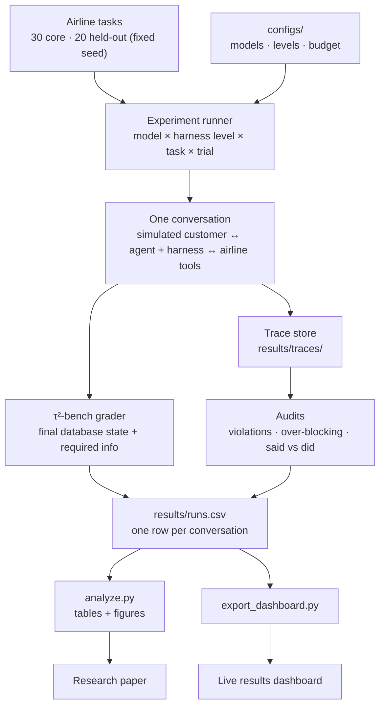
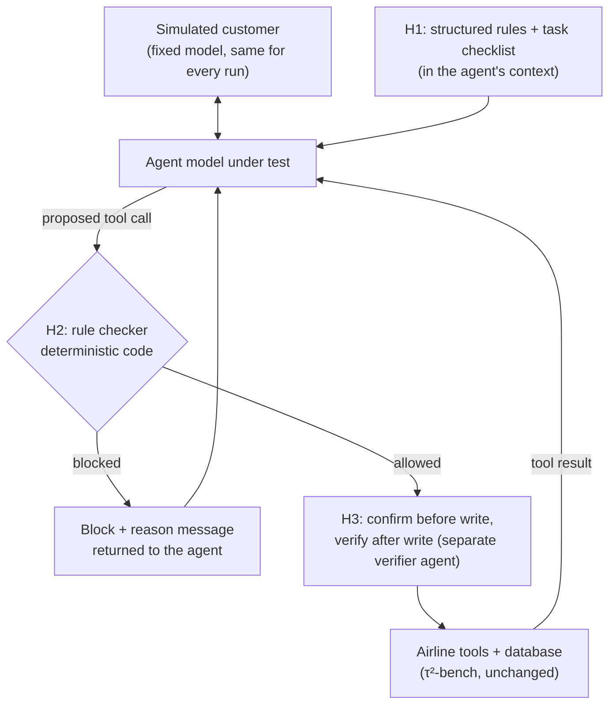

# PRD: How Much Harness Does a Low-Cost AI Agent Need?

**Measuring the minimum viable harness for rule-bound business agents**

Owner: Prerna Krishna Gade · Course: Advanced Topics in Generative AI (MAIB, SP Jain) · Status: approved topic, build starting 21 Nov 2026

---

## 1. Summary

Companies increasingly use low-cost LLM agents for customer operations: cancelling bookings, changing flights,
issuing refunds. Each action must follow a written company policy, and agents often break it. The usual fix is a
**harness**: everything built around the model, such as how the rules are presented, which actions are checked
before they run, and whether the agent confirms and verifies its work.

This study adds harness layers **one at a time** to cheap models on a standard airline customer-service benchmark
and measures what each layer buys in reliability and what it costs. It also asks the question every small business
faces: **is a cheap model with good rails better value than an expensive model without them?**

---

## 2. Problem statement

LLM agents deployed in customer operations act on real systems. When an agent cancels a non-refundable ticket,
changes a fare class that cannot be changed, or hands out compensation the customer is not entitled to, the business
loses money and trust. Recent benchmarks show this happens often. Agents can retrieve the correct rule and still
break it, and many failures are *silent*: the system accepts the forbidden action without an error, and the agent's
own message does not reveal it. In the airline domain of τ²-bench, one study found that 78% of a budget agent's
failures were silent wrong-state failures. The underlying airline API does not enforce the policy, so the agent
itself must check every rule before acting.

Practitioners respond by wrapping the model in a harness. Recent work shows the harness can matter as much as the
model: changing only the harness changes success rates, violation rates and even which model ranks best. But each
existing study tests **one kind** of harness component in isolation: an LLM reviewer, a compiled code gate, or a
workflow guide. Nobody has measured, on the same tasks and models:

- how much each layer adds when the layers are **stacked**,
- which layer delivers most of the gain, and whether any layer **hurts** by blocking legitimate actions,
- what each layer **costs** per successful, rule-compliant task, and
- whether a **cheap model with the full harness** beats a **stronger model with none**.

Without this evidence, teams either under-build (and ship agents that break policy) or over-build (and pay for
latency, tokens and complexity that add nothing). This study measures the **minimum viable harness**: the smallest
set of layers that makes a low-cost agent trustworthy, and its price.

---

## 3. Research questions and hypotheses

| # | Research question | Hypothesis |
|---|---|---|
| RQ1 | How do task success and rule compliance change as harness layers are added one at a time? | Compliance improves most from H0→H2; success gains are smaller and domain-dependent. |
| RQ2 | Which layer contributes most, and does any layer lower success by blocking legitimate actions? | The code gate (H2) gives the largest violation drop; some gates over-block. |
| RQ3 | How often does what the agent *says* it did differ from what it *actually* did (false claims and denials), and which layer reduces this? | Mismatch is driven by silent violations; H2 and H3 reduce it. |
| RQ4 | Does the harness gain shrink for a stronger model, and what does each safe completion cost at each level? | A cheap model + full harness reaches a stronger model's H0 reliability at lower cost per safe completion. |
| RQ5 (ext.) | Does the gate's *reason message* matter, or only the block? | Informative rejections improve recovery and success over silent blocks. |
| RQ6 (ext.) | Do compound requests (an action plus information questions) raise violations and invented answers? | Compound requests increase both; H1's checklist reduces them. |

---

## 4. What is new compared with prior work

| Study | What it did | Gap this study fills |
|---|---|---|
| *The Harness Is the Model* (2026) | Ablated harness components for 4 open-weight models on banking conduct rules | No deterministic gate, no cost per successful task, no strong-model comparison |
| *Reason Less, Verify More* (2026) | Deterministic gates on a budget agent, τ²-bench airline | No prompt-rule or verify layers, no cost per success, gates tested on the same tasks used to write them |
| *NOMOS* (2026) | Compiled policies into code gates on τ²-bench | Mainly one agent model, no layered comparison |
| *PolicyGuide* (2026) | LLM workflow guidance with frontier models | High cost; per-layer value for cheap models not measured |

**Contribution:** the first **cumulative ladder** of distinct harness types (rules → code gate → confirm/verify) on
cheap closed and open-weight models, reported as **cost per safe completion**, with a stronger-model reference,
over-blocking measurement, and (extension) held-out tasks and a reason-vs-no-reason gate test.

---

## 5. Scope

**Core (deadline 25 Nov 2026)**
- Claude Haiku 5.5, DeepSeek V4.1 Flash and Qwen3.6-35B-A3B (two open-weight models): H0, H1, H2, H3
- Claude Sonnet 5.5: H0 only (reference)
- 30 core airline tasks × 2 trials

**Extension (if time allows)**
- H2 with vs without the reason message
- 20 held-out tasks (generalisation)
- Sonnet 5.5 with H3 (does the harness gain shrink?)
- Cheap OpenAI and Gemini models: H0 vs H3
- ~10 custom compound-request tasks
- More trials for pass^k; per-rule-type table; said-vs-did audit with human spot-check

**Out of scope:** fine-tuning, building a new benchmark, real customer data, banking domain, non-English conversations.

---

## 6. Architecture

### 6.1 Pipeline overview

### 6.2 Inside one conversation

H0 has none of the H1/H2/H3 components: the model receives the policy text and tools and acts directly.

---

## 7. Harness levels

Each level includes everything in the level below it.

| Level | Adds | Plain-English role |
|---|---|---|
| **H0** | Model + tools + policy text pasted into the prompt | "Here's the rulebook, good luck" (baseline) |
| **H1** | Policy rewritten as short, numbered, structured rules plus a running task checklist the agent restates | A clear job aid |
| **H2** | Deterministic code gates that inspect each state-changing tool call and block policy violations with a reason | A supervisor who says "no, because…" |
| **H3** | Confirm before every write (explicit customer "yes") and verify the database after it, run by a separate verifier agent | "Measure twice, cut once" |

---

## 8. Rule checks

Grounded in the τ²-bench airline policy and in the categories of checks real customer-service systems apply.

| Category | Real-world purpose | Airline rule enforced | Layer |
|---|---|---|---|
| Authentication | Is this the customer? | Changes and cancellations need user ID + reservation ID; reservation must belong to the user and be read before it is written | H2 |
| Authorization | Are they allowed? | Passenger count can never change | H2 |
| Consent | Did they clearly agree? | Explicit "yes" after the action details are listed, before any database update | H3 |
| Eligibility | Does the booking qualify? | Basic economy cannot be modified; origin, destination and trip type fixed; no cabin change after any segment is flown; one cabin for all segments; cancellation only if booked within 24h, airline-cancelled, business class, or insured with a covered reason; no cancellation if any segment flown | H2 |
| Payment controls | Fraud and limits | Payment methods must be in the profile; max 1 travel certificate, 1 credit card, 3 gift cards; flight changes paid with a single gift card or credit card | H2 |
| Calculation | Correct amounts | Free-bag allowance by membership × cabin; $50 per extra bag; insurance $30 per passenger; bags can be added, not removed; insurance cannot be added after booking | H2 |
| Compensation guardrails | No unearned payouts | Certificate only for silver/gold, insured or business customers; $100 × passengers (cancelled flight), $50 × passengers (delayed flight, after the change) | H2 (amount, eligibility); H1 ("only if asked") |
| Honesty and scope | No invented answers | Share only information from the user or tools; no subjective recommendations | H1 + said-vs-did audit |
| Escalation | Hand over when needed | If any segment is flown, do not cancel; transfer to a human | H2 (block) + H1 (transfer) |
| Process | Orderly tool use | One tool call at a time; no tool call and user message in the same turn | Harness loop |

**H2 gate list (initial):** `auth_read_before_write`, `basic_economy_no_modify`, `modify_same_route`,
`cabin_change_rules`, `cancel_eligibility`, `passenger_count_fixed`, `bags_add_only_and_price`,
`insurance_at_booking_only`, `payment_rules`, `booking_limits`, `compensation_eligibility_and_amount`.
Each gate has a unit test with one allowed and one blocked case.

**Regulatory note (for the discussion section):** the benchmark encodes a company policy, not law. Real regulation
can differ. For example, the US DOT's 2024 automatic-refund rule requires cash refunds for cancelled or significantly
changed flights, whereas the benchmark allows only a travel-certificate gesture.

---

## 9. Experimental design

**Environment.** τ²-bench airline domain (50 tasks). We pin the τ²-bench commit and record it in every row.

**Task split.** 30 core and 20 held-out tasks, drawn once with a fixed seed and saved to `configs/tasks.yaml`.
Gates are written from the policy and core tasks only.

**Models.** Claude models run on the Anthropic API; open-weight models and the customer simulator run on OpenRouter.
The provider is recorded in every result row.

| Role | Model | Price per 1M tokens (in / out) |
|---|---|---|
| Cheap closed agent | Claude Haiku 5.5 (Anthropic API) | $0.10 / $0.50 |
| Cheap open-weight agent 1 | DeepSeek V4.1 Flash (weights public on Hugging Face) | $0.036 / $0.50 |
| Cheap open-weight agent 2 | Qwen3.6-35B-A3B (weights public; fallback Qwen3.8-27B, thinking off) | $0.05 / $0.70 |
| Reference agent | Claude Sonnet 5.5 (Anthropic API) | $2 / $10 |
| Customer simulator | One cheap model from a family not under test, temperature 0, fixed for the whole study | confirm at the pilot |

**Trials.** 2 per task in the core, more in the extension. Fixed seeds.

**Budget estimate** (to be replaced by real numbers after the pilot). Assumes ~165k input and ~2.5k output tokens
per conversation for the agent, before prompt caching.

| Block | Runs | Rough cost |
|---|---|---|
| Haiku 5.5, H0-H3 | 240 | ~$4-5 |
| DeepSeek V4.1 Flash, H0-H3 | 240 | ~$1.70 |
| Qwen3.6-35B-A3B, H0-H3 | 240 | ~$2.40 |
| Sonnet 5.5, H0 | 15-30 | ~$5-11 uncached; much less with caching |
| Customer simulator | ~750 | ~$4-6 |

Total core: about $15-18 uncached, $10-13 with prompt caching and Sonnet limited to 15 tasks.
Split by provider: OpenRouter (DeepSeek, Qwen, customer simulator) about $8-10, within the $10 key cap;
Anthropic credits (Haiku, Sonnet) about $5-15 depending on caching and the number of Sonnet tasks.

---

## 10. Metrics

| Metric | Definition |
|---|---|
| Pass rate (pass^1) | Share of conversations the τ²-bench grader marks correct |
| Consistency (pass^k) | Share of tasks passed on all k trials |
| Violation rate | Share of state-changing calls that broke a policy rule (from traces, checked against the rule list) |
| Safe completion | Passed **and** zero violations |
| **Cost per safe completion** | Total spend ÷ number of safe completions (headline metric) |
| Over-blocking rate | Share of H2 blocks on actions the task's expected trajectory allows |
| Said-vs-did mismatch | Agent's final claim contradicts the database (false "done" or false "not done"); LLM judge + ~30 human-checked cases |
| Tokens, latency, turns | Per conversation |

---

## 11. Data schema: `results/runs.csv`

`run_id, timestamp, model_id, harness_level, gate_reason_on, task_id, split, trial, seed, tau2_commit,
reward, passed, n_violations, violated_rules, n_blocks, n_false_blocks, said_vs_did_flag, input_tokens,
cached_tokens, output_tokens, cost_usd, latency_s, n_turns, error`

---

## 12. Live results dashboard

One dashboard, updated after every batch from `results/runs.csv`:
- headline cards: pass rate, violation rate, cost per safe completion per level
- success by harness level for each model
- cost vs reliability: cheap + harness vs Sonnet H0
- violations by rule category, and which layer removes them
- evals table: over-blocking, said-vs-did, per-rule results
- progress tracker and findings log

---

## 13. Risks and mitigations

| Risk | Mitigation |
|---|---|
| Budget overrun | Dry-run cost estimates, per-key credit cap, prompt caching, Sonnet limited to 15 tasks if needed |
| Open-weight model fails at tool calling | Pilot on 5 tasks; fall back to Qwen3.8-27B (thinking off) or DeepSeek V3.1 before the full run |
| Credit cap reached mid-batch | Budget guard checks before each batch; cut-off runs logged as `error=credit` and re-run, never scored as failures |
| Gates over-block | Precision audit against expected trajectories; report it as a finding |
| Small sample (2 trials) | Report confidence intervals; label core results as indicative; extension adds trials |
| Customer simulator noise | Fixed model and settings; different model family from the agents; 2 trials |
| Overfitting gates to tasks | Held-out split (extension), gates written from policy + core only |
| Time | Core scope frozen; extension only adds rows |

---

## 14. Timeline

| Day | Work | Output |
|---|---|---|
| Sat 21 Nov | Set up τ²-bench + OpenRouter; task split; harness switches; $0.50 pilot | Working pipeline, real cost per run |
| Sun 22 Nov | H1 rules, H2 gates + tests, H3 verifier; Haiku, DeepSeek, Qwen H0-H3 | Main results |
| Mon 23 Nov | Sonnet H0; analysis; dashboard | Full comparison |
| Tue 24 Nov | Write paper | Draft |
| Wed 25 Nov | Final checks, submit | Paper |
| Extension (+7 days) | Extension items in §5 | Stronger paper |

---

## 15. Deliverables

1. GitHub repository with code, README and one-command reproduction
2. `results/runs.csv` and full traces
3. Figures (PNG) and the live results dashboard
4. Research paper

---

## 16. References

Details marked [verify] must be checked against the source before the final paper.

**Benchmarks and agent foundations**
1. Yao, S., Shinn, N., Razavi, P., Narasimhan, K. (2024). τ-bench: A benchmark for tool-agent-user interaction in real-world domains. arXiv:2406.12045.
2. Barres, V., Dong, H., Ray, S., Si, X., Narasimhan, K. (2025). τ²-bench: Evaluating conversational agents in a dual-control environment. arXiv:2506.07982.
3. Yao, S., et al. (2023). ReAct: Synergizing reasoning and acting in language models. ICLR 2023. arXiv:2210.03629.
4. Yu, B., et al. (2026). CXBench: A benchmark for process-compliant LLM agents in regulated customer-experience workflows. arXiv:2610.25954.

**Harness as a research object**
5. Zhong, H., Zhu, S. (2026). AI Harness Engineering: A runtime substrate for foundation-model software agents. arXiv:2605.13357.
6. Barbaste, Darrigol, Vu, Wiltberger (2026). Harness Engineering: Anatomy, architecture, and evolution of coding agents. A source-code study of eleven systems. arXiv:2609.00006.
7. Zhang, Y., Wang, J., Ge, Y., Xu, W., Hamm, J., Reddy, C. K. (2026). Stop comparing LLM agents without disclosing the harness. arXiv:2605.23950.
8. Pan, L., et al. (2026). Natural-language agent harnesses. arXiv:2603.25723.

**Measured harness effects**
9. The Harness Is the Model: Agent scaffolding changes a fixed LLM's compliance with banking conduct rules, unevenly across models (2026). arXiv:2611.06116. [verify authors]
10. Don't Blame the Large Language Model (2026). Ben Sghaier et al. arXiv:2607.03691. [verify full title and authors]
11. Lin, J., Liu, S., Pan, C., et al. (2026). Agentic Harness Engineering: Observability-driven automatic evolution of coding-agent harnesses. arXiv:2604.25850.
12. How Much of a Harness Does a Strong Agent Need? (2026). arXiv:2609.40303. [verify authors]
13. Grow the Harness, Not the Context (2026). arXiv:2609.26760. [verify authors]
14. HarnessFlow: MCTS-guided harness optimization for LLM agents (2026). arXiv:2611.06254. [verify authors]

**Rule enforcement and policy compliance**
15. Reason Less, Verify More: Deterministic gates recover a silent policy-violation failure mode in tool-using LLM agents (2026). arXiv:2607.07405. [verify authors]
16. Yu, M.-Y., Kim, T., Choi, J. W. (2026). NOMOS: Compiling written policies into statically verified tool-call gates for LLM agents. NeurIPS 2026. arXiv:2610.11030.
17. PolicyGuide: From guarding one action to guiding the whole workflow for policy-compliant LLM agents (2026). arXiv:2608.19861. [verify authors]
18. Wang, H., Poskitt, C. M., Sun, J. (2026). AgentSpec: Customizable runtime enforcement for safe and reliable LLM agents. ICSE 2026. arXiv:2503.18666. [verify]
19. Policy documents compiled into tool guard code for business-process agents. EMNLP 2025 Industry Track. arXiv:2507.16459. [verify title and authors]
20. AutoSOP (2026). NeurIPS 2026. [verify title, authors, link]
21. LEANGUARD: Lean-verified guardrails for tool-using agents (2026). arXiv:2611.02332. [verify authors]
22. HANDBOOK.md benchmark: agents retrieve the correct rule, violate it, and report compliance (2026). arXiv:2607.25398. [verify title and authors]

**Practitioner sources**
23. Hashimoto, M. (2026). My AI adoption journey. mitchellh.com/writing/my-ai-adoption-journey
24. OpenAI (2026). Harness engineering. openai.com/index/harness-engineering/
25. Anthropic Engineering (2025). Effective harnesses for long-running agents. anthropic.com/engineering/effective-harnesses-for-long-running-agents
26. Ji, Y. (2025). Context engineering for AI agents: Lessons from building Manus. manus.im/blog/Context-Engineering-for-AI-Agents-Lessons-from-Building-Manus

**Regulation (discussion section)**
27. U.S. Department of Transportation (2024). Refunds and Other Consumer Protections, Final Rule. 89 FR 32760 (26 April 2024).

**Pilot evidence**
28. Gade, P. K. (2026). RLM vs RAG on logistics data (scaffolding around a fixed model raised aggregation accuracy from 0.15 to 0.60). github.com/Prerna-02/rlm-vs-rag-logistics
